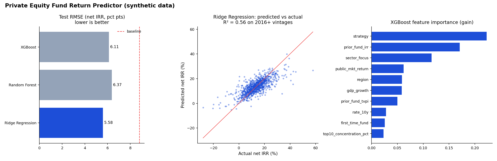

# Private Equity Fund Return Predictor

A machine-learning system for forecasting private equity fund returns (net IRR) from historical performance, fund terms, portfolio risk indicators and market conditions. It compares **Ridge Regression, Random Forest and XGBoost** and evaluates them the way a screening model is used: train on older vintage years, test on newer ones.



## Results (synthetic data, 2016–2020 vintages held out)

| Model | Test RMSE (IRR pct pts) | MAE | R² |
|---|---|---|---|
| Baseline (training mean) | 8.80 | 6.63 | −0.09 |
| **Ridge Regression** | **5.58** | **4.00** | **0.56** |
| XGBoost | 6.11 | 4.46 | 0.47 |
| Random Forest | 6.37 | 4.79 | 0.43 |

**As a screening tool:** the funds the best model ranked in the top quartile of their vintage and strategy were actually top quartile **58.5%** of the time, against 25.7% by chance, with an average net IRR of 18.9% versus 13.4% for all test funds.

Ridge wins here because most of the simulated relationships are close to linear; on real fund data with stronger interactions, the tree models may do better. `results/` holds the metrics, the screening summary and the feature importances.

## About the data

Fund-level returns from Preqin, PitchBook, Burgiss or Cambridge Associates are licensed and can't be published, so `src/make_dataset.py` **generates a synthetic dataset** (4,000 funds, vintages 2000–2020). It encodes relationships documented in private equity research:

- **Manager persistence:** a GP's prior-fund IRR and TVPI predict the next fund.
- **Vintage cycles:** entry valuations, GDP growth and public-market returns.
- **Diseconomies of scale:** returns fall off for very large funds.
- **Strategy:** venture has the widest dispersion of returns.
- **Leverage:** helps buyouts in low-rate environments.
- **Fees and GP commitment:** higher fees hurt; more GP skin in the game helps.

**No number in this repo describes a real fund.**

To train on real data, export a CSV with the same columns (see `src/train.py`: `CATEGORICAL`, `NUMERIC` and the `net_irr_pct` target) and pass it with `--data`.

## Features

| Group | Columns |
|---|---|
| Fund | strategy, region, sector focus, fund size, fund number (first-time fund flag) |
| Track record | prior fund net IRR, prior fund TVPI |
| Terms | management fee, GP commitment |
| Portfolio risk | leverage (debt/EBITDA), number of portfolio companies, top-10 concentration, IPO exit share |
| Market | GDP growth, 10-year rate, entry EV/EBITDA, public market return |

## Run it

```bash
python -m venv .venv && source .venv/bin/activate
pip install -r requirements.txt
python src/make_dataset.py            # writes data/pe_funds_synthetic.csv
python src/train.py --test-from 2016  # trains, evaluates, saves results/
```

On macOS, XGBoost needs the OpenMP runtime (`brew install libomp`).

Built with Python, pandas, scikit-learn, XGBoost and matplotlib.
